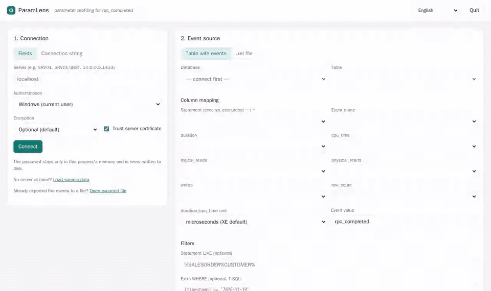
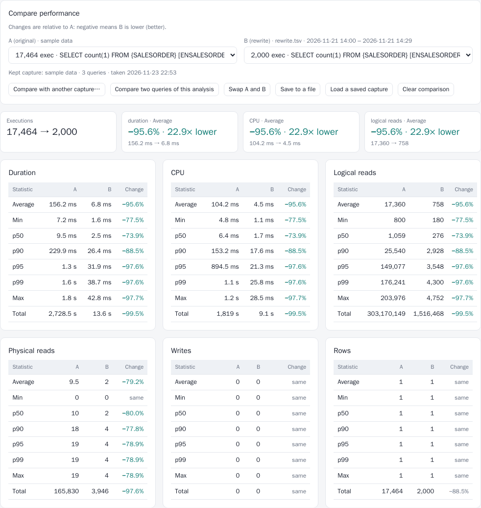

# ParamLens

**Parameter profiling for SQL Server Extended Events `rpc_completed` captures.**

ParamLens reads the `exec sp_executesql …` calls captured by Extended Events and shows how the
application really calls each query: parameter value distributions, combinations, cost per call
pattern and, above all, *catch-all* predicates (`@p = 0 OR col = @p`) that turn into a pass-through in
most executions. Built for the usual ORM/low-code problems (OutSystems, Entity Framework, …): optional
ORs, parameter sniffing, inline `IN` lists and parameter type/size variations.

**[▶ Try it online](https://italombs.github.io/ParamLens/?demo=1)**: the full analysis runs in your browser on
synthetic sample data. Nothing to install, nothing uploaded.

**[See the feature tour with screenshots →](docs/tour.md)**

## Download

| | |
|---|---|
| **[ParamLens.exe](../../releases/latest/download/ParamLens.exe)** | Windows, single executable, no installation. Connects to SQL Server. |
| **[ParamLens.html](../../releases/latest/download/ParamLens.html)** | Any browser, fully offline. Analyzes a file you export from SQL Server. Use it when you cannot run the `.exe`. |

Every version ever published stays available on the [Releases](../../releases) page, each with a
`.sha256` checksum. The `.exe` is not code-signed, so Windows SmartScreen may ask for confirmation
(**More info › Run anyway**).

## Quick start

**With the `.exe`**

1. Run `ParamLens.exe`: the interface opens in its own window (closing it quits).
2. Connect to the SQL Server and pick the table with the captured events (or a `.xel` file on the server).
3. Click **Analyze** and start with the **All findings** tab.

**With the `.html`**

1. Open `ParamLens.html` in the browser.
2. Export the events: the page builds the `bcp` command and the SSMS query for you. A plain `SELECT *`
   of the event table saved as CSV also works.
3. Drop the file onto the page and click **Analyze**.

No server at hand? In the `.exe`, **Load sample data** shows everything with synthetic data.
The interface is in English and can be switched to Portuguese (pt-BR) in the header.

More in the [user guide](docs/user-guide.md).

## What it shows

- **Catch-all predicates** (`@x = 0 OR …`, `@d = @nullDate OR …`, `ISNULL(@p, …)`) and the % of executions
  in which each one is true, with the average cost in both cases.
- **Call shapes:** which filters were really applied together, with % of executions and % of cost.
- **Parameters:** type, cardinality, most frequent values, % NULL, value classes (NULL, 0, '', null date…).
- **Combinations** of parameter values of your choice, exportable as CSV.
- **Inline IN lists** as pseudo-parameters, and how many distinct SQL texts they create.
- **Findings** ranked by severity: dominant values with unequal cost (parameter sniffing), diverging
  parameter declarations, constant parameters, disproportionately expensive combinations.
- **Test script:** `DECLARE` + SQL of a real execution, ready for SSMS.
- **Parameter export:** the exact values of every call of a query (one row per execution or per
  combination) as a SQL script with an optional replay loop for Query Store, as CSV, or inserted straight
  into a table of your choice. Hard-coded values of the SQL go too: inline `IN` lists as comma-separated
  text for `STRING_SPLIT`, and literals compared with a column.
- **Executions over time:** every call of a query with its date and time, or grouped per minute, hour, day,
  hour of the day or day of the week, to see when it runs and when it gets slow.
- **Before × after comparison:** pick the original query and the rewrite, in the same capture or in two
  captures (another table, `.xel` or file), and get the change in average, p50, p95, p99 and max of
  duration, CPU and reads.
- **HTML report** you can export and open offline.

## From diagnosis to a measured fix

1. **Find** the catch-all ORs, sniffing-prone values and expensive call shapes of a query.
2. **Export its parameters** exactly as the application sent them and replay them against the original
   and the rewritten query (SQLQueryStress, Query Store, a test database).
3. **Capture both runs** with Extended Events and **compare** them: the change per metric and
   percentile, with a warning when the rewrite returns a different number of rows.

*Sample data against a synthetic capture of a rewrite: try it with **Load sample data**, or see the
[feature tour](docs/tour.md).*

## Privacy

Captured statements often hold sensitive data, so ParamLens keeps everything on your machine: it only
connects to the SQL Server you specify, has no telemetry and makes no other network calls. The `.exe`
listens on `127.0.0.1` only, with a per-session token; the `.html` reads the file in the browser and never
uploads it. See [SECURITY.md](SECURITY.md).

## Contributing

Bug reports, parser cases from real captures (anonymized!), translations and code are welcome — see
[CONTRIBUTING.md](CONTRIBUTING.md). Build and architecture notes are in
[docs/development.md](docs/development.md); changes per version in [CHANGELOG.md](CHANGELOG.md).

## License

[MIT](LICENSE) © 2026 Italo Mesquita
