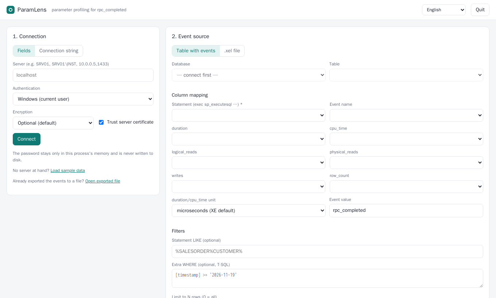
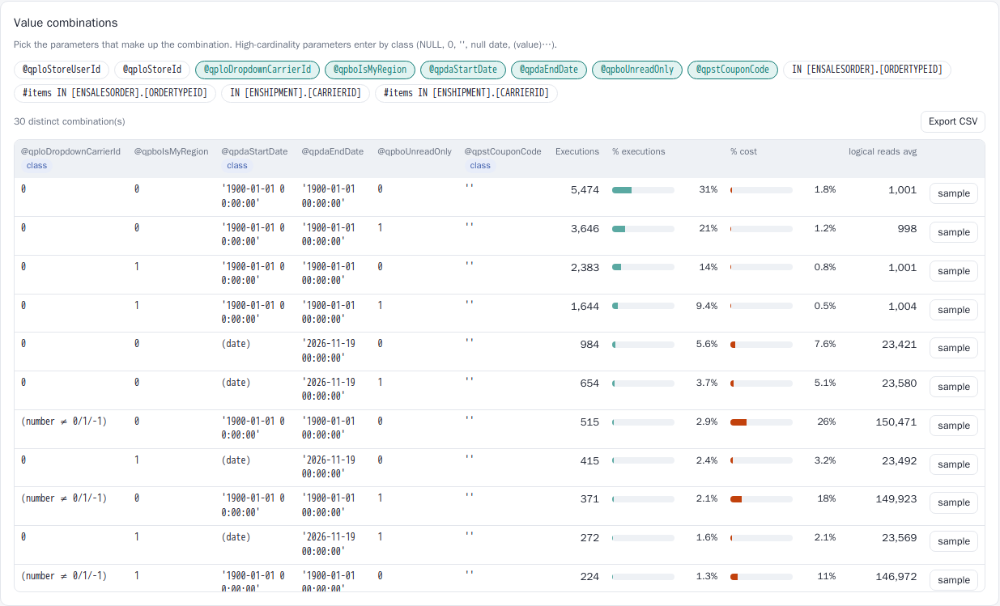
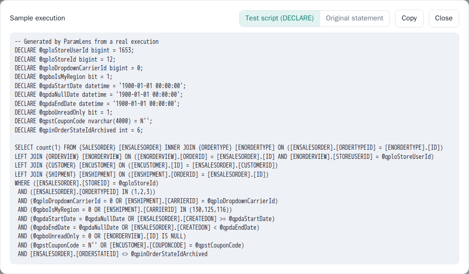
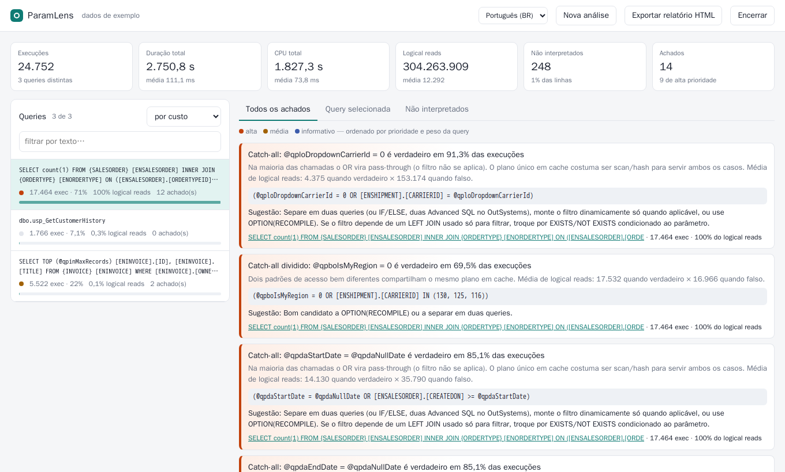
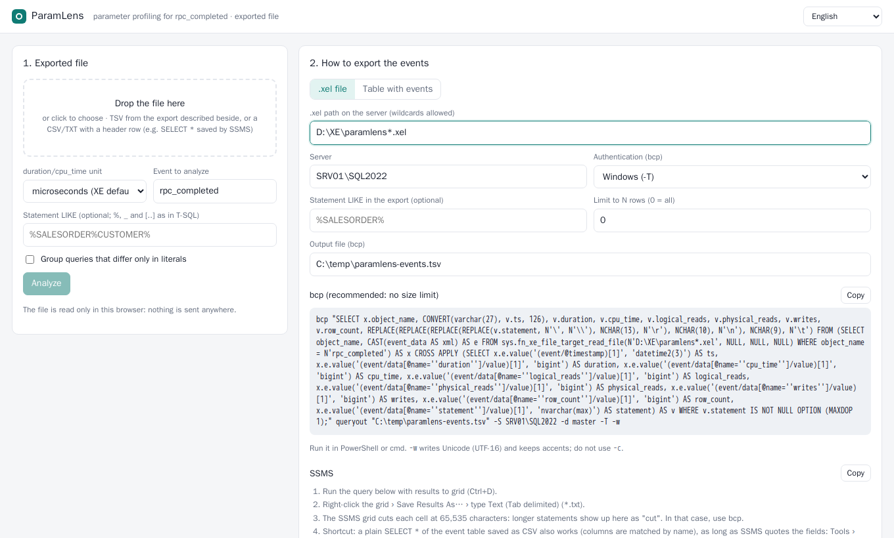
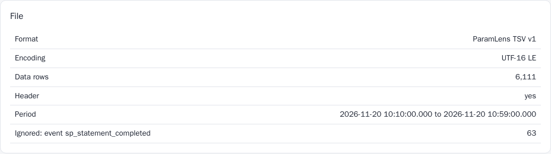

# Feature tour

All screenshots use the built-in **sample data** (synthetic, OutSystems-style queries over a fictitious
orders/customers/invoices schema). Try it yourself: run `ParamLens.exe` and click **Load sample data**.

## 1. Connect

`ParamLens.exe` opens a local page in your browser. Connect with Windows or SQL Server authentication and
pick the source: a table with the captured events or a `.xel` file on the server.

## 2. Findings first

The first screen lists every finding, ranked by severity and by how much the query weighs in the
workload, each with an explanation, the SQL snippet and a suggestion. The left side lists the distinct
queries ("families") by cost.

## 3. Catch-all predicates

For each optional filter like `@p = 0 OR col = @p`, the % of executions in which the parameter side is
true — that is, in which the OR filtered nothing — and the average cost in both cases.

## 4. Call shapes

Which catch-alls actually filtered together, with their share of executions and of cost. Here, the
shape that filters only by carrier is 2.9% of the calls but 26% of the logical reads (about 150,000
reads per call against about 1,000 when nothing is filtered): a classic candidate for a separate query
or `OPTION(RECOMPILE)`.

## 5. Parameters

Type, cardinality, most common value and % NULL of every parameter. Click a row to see its value
distribution and the cost per value. Inline `IN (…)` lists show up as pseudo-parameters (values and size).

## 6. Value combinations

Pick the parameters that matter and see how their values occur together and what each combination costs.
High-cardinality parameters enter by class (NULL, 0, '', null date, (number)…). Export as CSV.

## 7. A real execution, ready to test

Any **sample** button opens one real execution of that row: the original statement, or a test script with
the `DECLARE`s and the SQL, ready to paste into SSMS and look at the plan.

## 8. English or Portuguese

The interface is in English by default and can be switched to Portuguese (pt-BR) in the header; numbers
follow the selected language. Exported reports can switch too.

## 9. The standalone HTML version

`ParamLens.html` does not connect to SQL Server: it builds the export command for you (bcp or an SSMS
query, for a `.xel` file or a table), and you drop the exported file onto the page. Everything runs in the
browser, offline.

After the analysis, the **Not parsed** tab also describes the file: format, encoding, period and the
events that were skipped.

